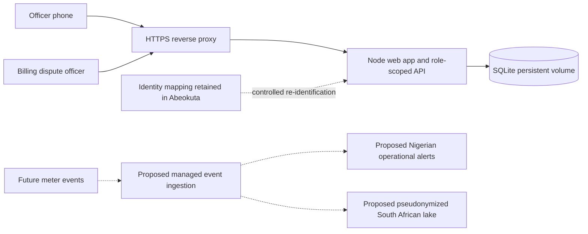

# Sunbeam application documentation

Student AGL202607071 · D=1 · Small: 200,000 meters / 500 feeders · feeder suffix 1 · Task 4: six-hour South African region outage.

## Scope and architecture

The primary user is the field revenue officer working from a phone. The three supported decisions are monthly field-team prioritization, operational outage awareness within a proposed fifteen minutes, and daily review of estimated billing and disconnections. This Task 1 deployment is a small vertical slice of the eventual platform, not the production data platform.

Dashed links are proposed future components. The delivered app requires neither the lake nor the vault. It stores only fictional customer codes and synthetic operating examples. In production, customer visit identity must come from an explicitly authorized Nigerian identity service, not from unrestricted lake access.

## Implemented components

- Node.js HTTP server serving same-origin assets and JSON APIs; no external runtime dependencies.
- SQLite WAL database with `visits`, `reports`, `appeals`, and `audit` tables. The database is teaching-scale and single-instance.
- Password verification using scrypt and timing-safe comparisons; random HttpOnly, SameSite=Strict session cookies with eight-hour expiry. Secure cookies when HTTPS is configured.
- Origin checks on mutations, JSON-only payloads, bounded request bodies and escaped rendering of stored user text.
- Server-side feeder scope and role checks. The field officer cannot submit a visit for the restricted feeder-2 fixture, review appeals or read audit history. The billing reviewer cannot create field reports or submit customer appeals.
- Field reports and appeal decisions persisted across process restarts. Session and rate-limit state are intentionally in-memory.
- Static outage evidence, energy reconciliation chart and deterministic policy-help assistant.

## API contract

| Method and path | Access | Purpose |
|---|---|---|
| GET `/healthz` | Public | Process and SQLite connectivity |
| GET `/api/config` | Public | Demo-mode flag and assignment variables |
| POST `/api/login` | Public with rate limit | Username/password login |
| POST `/api/logout` | Signed-in | Invalidate current session |
| GET `/api/state` | Signed-in | Assigned synthetic state; excludes out-of-scope visits |
| POST `/api/visits/:id/report` | Field; feeder 1 | Save finding and evidence; update status |
| POST `/api/appeals` | Field; assigned customer | Submit for human review |
| POST `/api/appeals/:id/review` | Reviewer | Reasoned correction/evidence request |
| GET `/api/audit` | Reviewer | Latest 100 audit events |
| POST `/api/assistant` | Signed-in | Bounded policy assistance |

All mutations require `Content-Type: application/json` and an `Origin` equal to `APP_ORIGIN`. API responses use `Cache-Control: no-store`. The server applies CSP, frame denial, no-sniff and no-referrer headers. Error responses contain a readable `error` string. No password or session token is returned in JSON.

## Data and calculations

Six visible fictional customer references belong to feeder 1; a seventh fixture is deliberately on feeder 2 for authorization testing. The trend consists of seven days, 26 October–1 November 2026. Supplied energy is 272 MWh; billed energy 207 MWh; unexplained difference 65 MWh (23.9%). These totals are computed from displayed data. This includes technical loss and data issues, so it is not described as measured commercial theft. No tariff, billed naira amount or legal cap is fabricated.

The outage example has event time 08:59, receipt 09:03 and alert time 09:04 WAT on 1 November. It demonstrates timing presentation only. Actual event ingestion, unit conversion, deduplication and forecasting remain future work. The Module 5 generator was not supplied; the committed settings file preserves the requested 500-meter/10-feeder/30-day configuration without pretending that the practical dataset has been generated.

## Responsible use and transfer position

Consumption linked to a customer is personal data. Household patterns are treated as highly sensitive in this design without asserting that every reading automatically belongs to a statutory special category. Pseudonymization does not remove data-protection duties. Before sending readings abroad, Sunbeam must document purpose, lawful basis, minimization, a transfer assessment, appropriate safeguards, retention and the DPO's review. Hosting in South Africa is not presumed legally adequate simply because customer names are removed.

Billing decisions require verified evidence and the applicable approved rules. The internal app refuses automated disconnection and guilt attribution. Estimated customers must not be given invented meter readings. Rural network delay must not become evidence of wrongdoing. Future loss models require time-based evaluation, review of metered/estimated and urban/rural outcomes, explanations and a route to challenge priorities. This app has no trained model and makes no predictive accuracy claim.

## Production boundary

This is a deployable educational model, not a production utility platform. Before real customer use: replace the two shared role accounts with individual identity-provider accounts and MFA; use durable sessions and distributed rate limits; verify least-privilege identity retrieval; establish retention and deletion policy; ship audit logs off-host; provision encrypted disks and backups; run restore and failure drills; implement monitoring; assess third-party data transfers; and load-test the actual pipeline. SQLite is not the store for 19.2 million daily production readings. The three engineers should use managed services where feasible rather than operate a distributed platform.

## Sources checked 4 November 2026

- Assignment supplied in `Task 1 (ATC 405).docx` — source of scenario, student variables and deliverables.
- [NERC Customer Protection Regulations 2023](https://nerc.gov.ng/resources/customer-protection-regulations-2023/) — billing, disconnection and complaint framework.
- [NERC consumer rights](https://nerc.gov.ng/need-help/services/consumer-rights-obligations/) — transparent billing, approved estimation and complaint rights.
- [NERC complaints procedure](https://nerc.gov.ng/need-help/services/how-to-file-a-complaint/) — DisCo complaint unit, Forum, Commission escalation.
- [NDPC Act publication](https://www.ndpc.gov.ng/ndp-act-2023/) and [NDPC FAQ](https://ndpc.gov.ng/faqs/) — Act and cross-border transfer protection. No numeric cap or final transfer-law conclusion is hardcoded; verify applicable current instruments before a real implementation.
